<p align="center">
  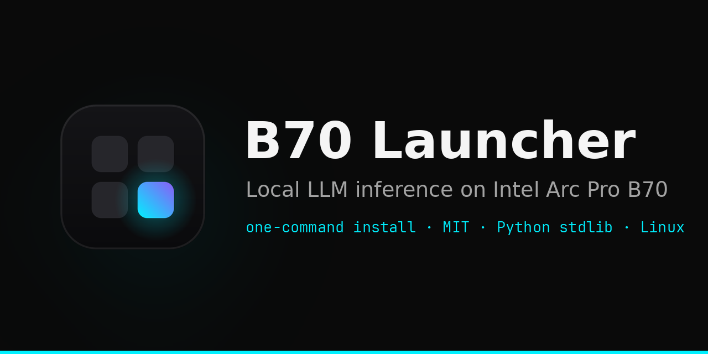
</p>

<p align="center">
  <a href="https://github.com/SergiioB/b70-launcher/releases/latest"></a>
  <a href="LICENSE"></a>
  
  
  <a href="https://github.com/SergiioB/b70-launcher/actions/workflows/test.yml"></a>
</p>

# B70 Launcher 0.6.14 (Linux source)

Local desktop launcher for LLM inference on the Intel Arc Pro B70. Model library → recipe pick (vLLM XPU / llama.cpp SYCL / OpenVINO / EXL3) → inspect the exact command → launch & test. Pure Python stdlib — no pip install, no bundled binaries.

```sh
curl -fsSL https://xecores.com/downloads/get.sh | sh
```

## How it looks

<table>
  <tr>
    <td>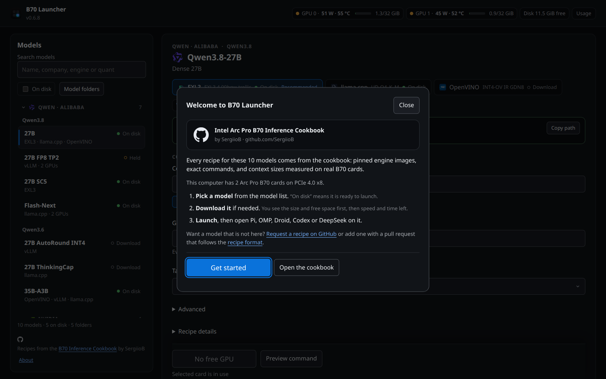</td>
    <td>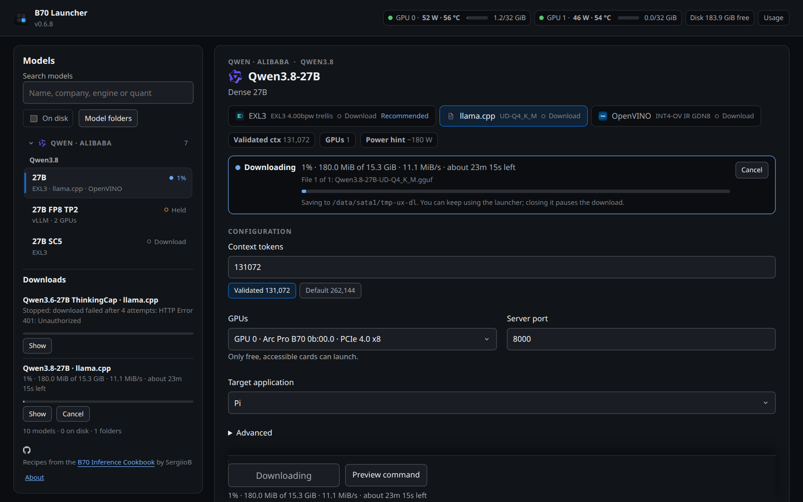</td>
  </tr>
  <tr>
    <td>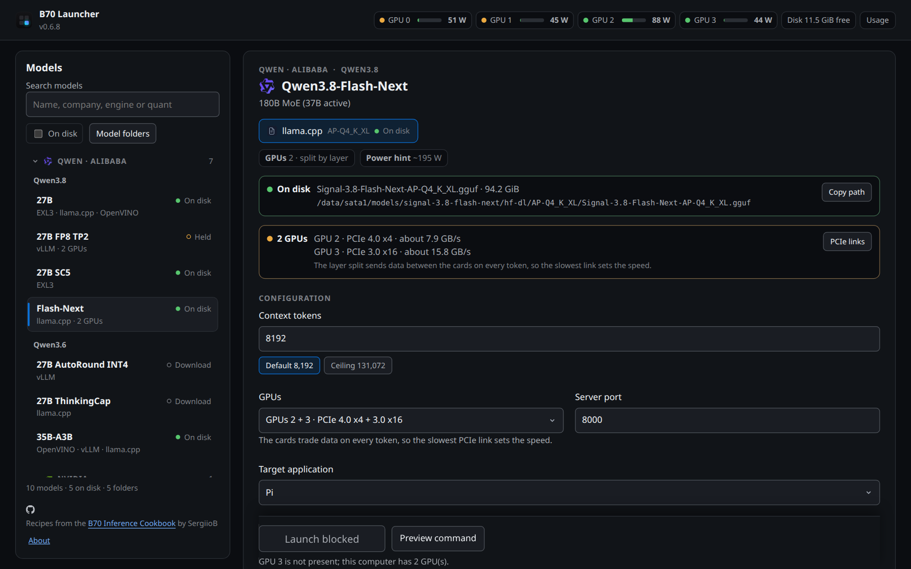</td>
    <td>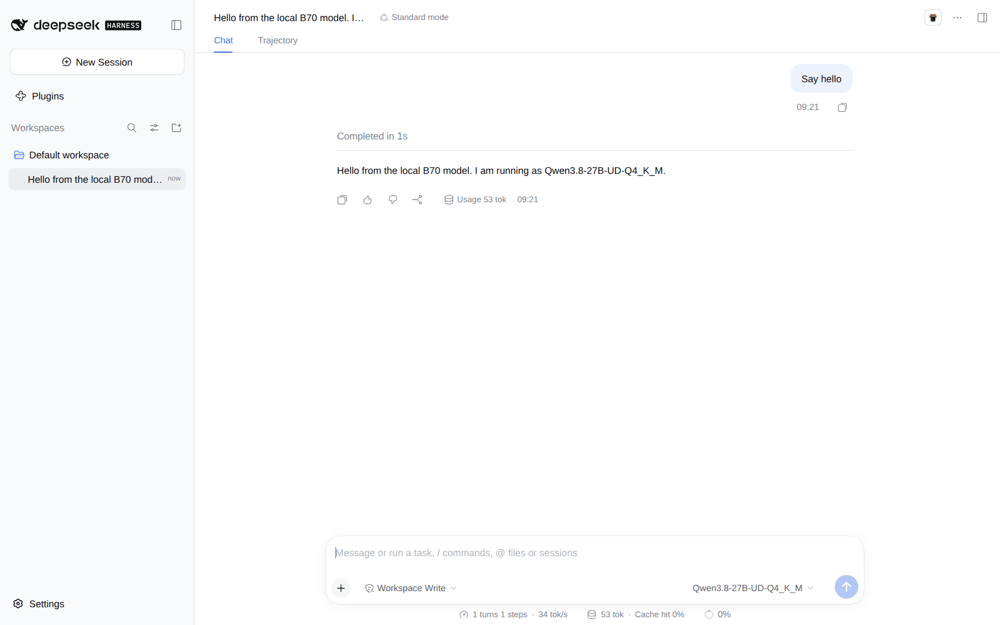</td>
  </tr>
  <tr>
    <td>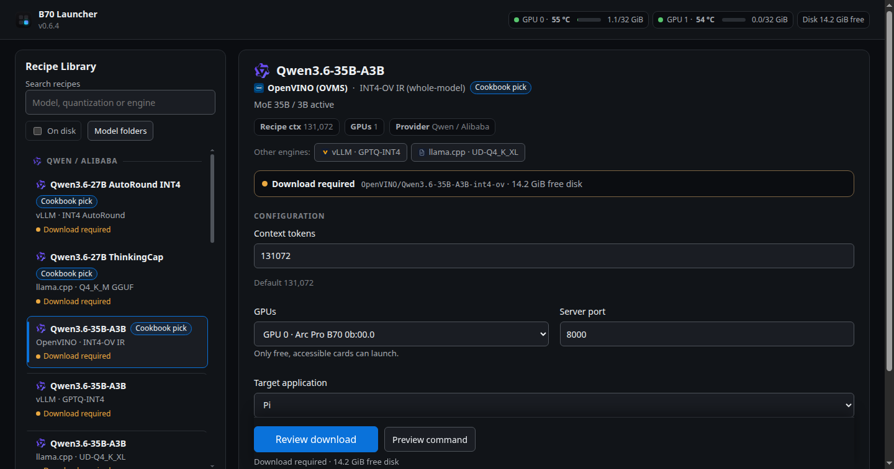</td>
    <td>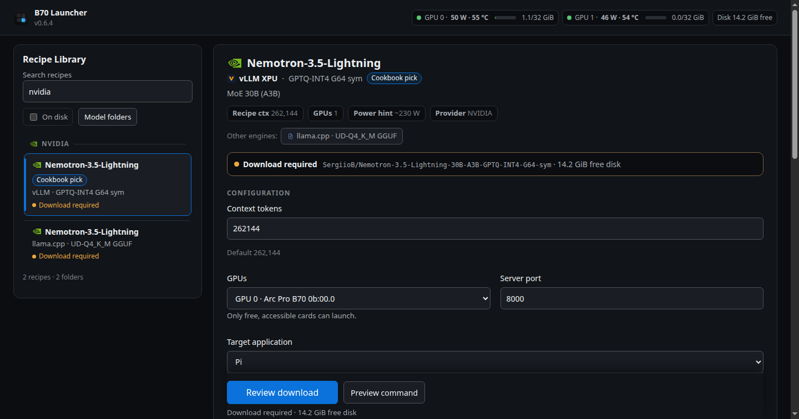</td>
  </tr>
  <tr>
    <td>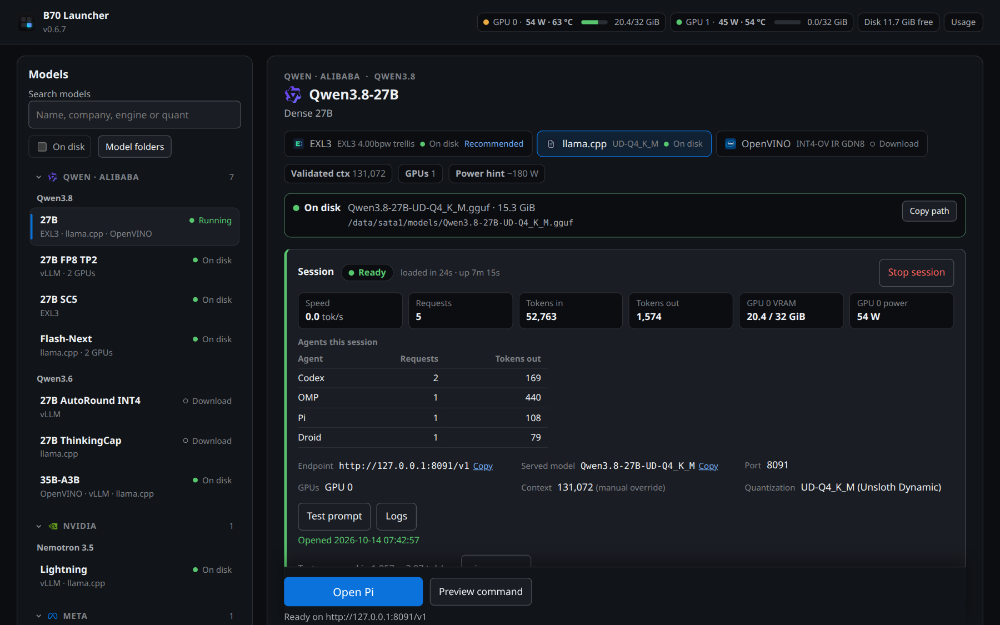</td>
    <td>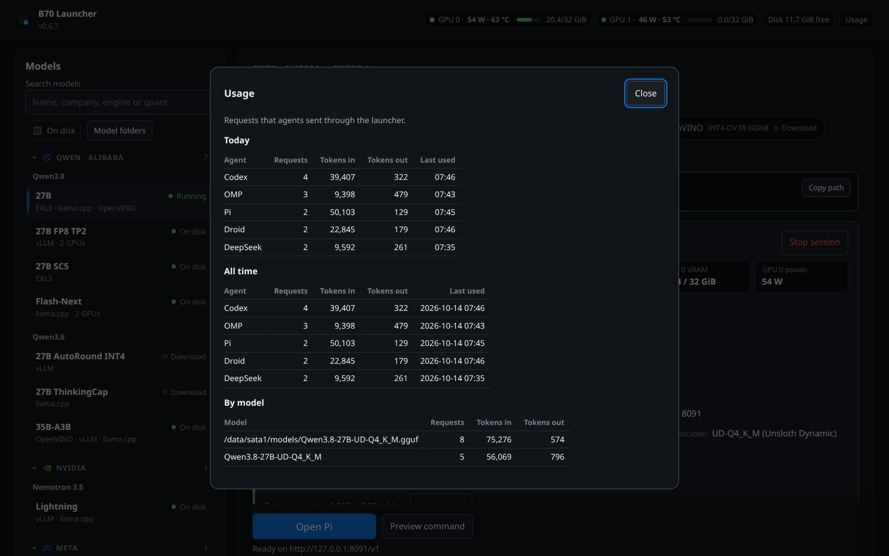</td>
  </tr>
  <tr>
    <td>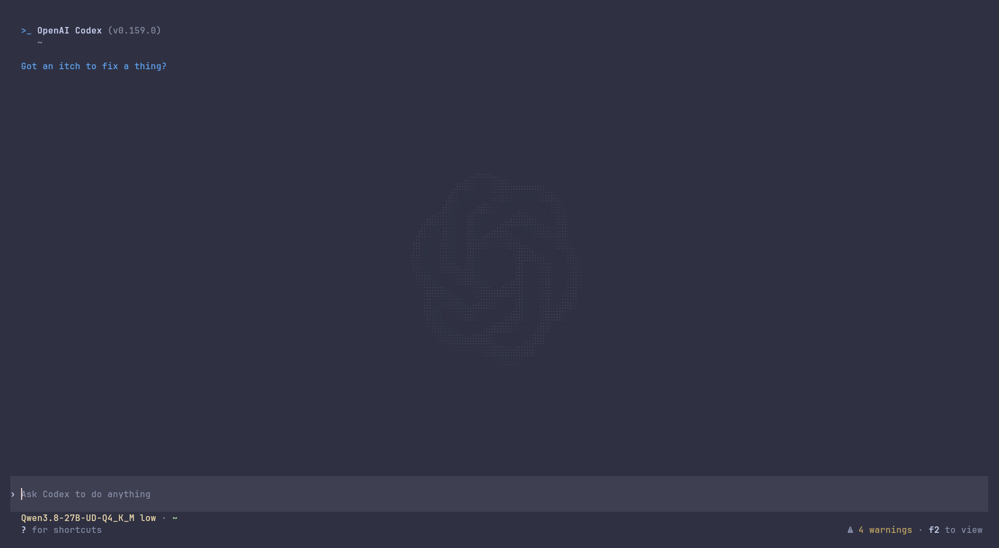</td>
    <td>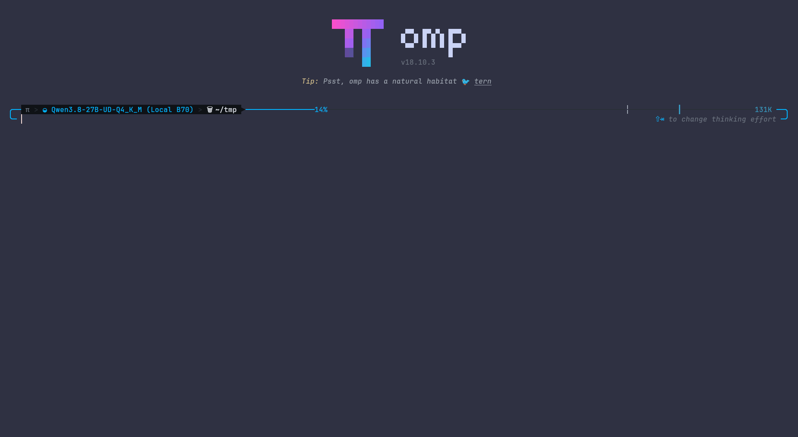</td>
  </tr>
</table>

**How it works:** pick a model → pick an engine recipe (vLLM XPU / llama.cpp SYCL / OpenVINO / EXL3) → inspect the exact command (dry-run preview) → launch. Running servers survive restarts and are re-adopted; recipe updates arrive over the release channel and apply as state overlays — your install is never rewritten.

## Run it

```sh
b70-launcher                 # open the app
b70 list                     # models and engines on this machine
b70 launch qwen38-27b        # start a model and wait until it answers
b70 agent pi                 # open an agent on it: pi, omp, droid, codex or deepseek
b70 usage                    # tokens per agent, today and all time
b70 stop                     # stop the model
```

## What is new in 0.6.14

- **New route: Nemotron 3.5 Bolt 74B-A9B on two B70s with vLLM.** Our AutoRound int4 build runs tensor parallel on two cards, both capped at 180 W. Decode is 60.5 tok/s on an 886-token prompt and 23.0 tok/s on a 64,000-token prompt; prefill is 2,925 and 486 tok/s. Median of 5 runs on one host. The one-card llama.cpp recipe stays the default.
- **64K context by default, 262K if you ask.** The full 262,144 tokens load, and the model found a fact hidden in a 249K-token prompt, but reading a 250K prompt takes about 35 min.
- **Recipes can run an entry script.** A two-card vLLM recipe can name a start script and the patches it needs. The launcher mounts them and refuses to start if one is missing.

## What is new in 0.6.13

- **New model: Nemotron 3.5 Bolt 74B-A9B.** NVIDIA's 24 GB GGUF runs fully on one B70 with image input, from a patched llama.cpp SYCL image. Prefill is about 850 tok/s on a short prompt and 1,281 tok/s on a 32K prompt; decode is 26.3 tok/s. The full 262,144-token context fits in 26.5 GiB, and the model found a fact hidden in a 250K-token prompt. No draft model: Bolt has no MTP head, and NVIDIA's DFlash drafter is slower on this card.
- **Recipe settings for llama.cpp.** A recipe can set `GGML_SYCL_*` engine settings. Only the installed recipe file can set them; recipe updates from the web cannot.

## What is new in 0.6.12

- **Prompt cache on for Nemotron DFlash too.** Its second check on this host gave the same answers with the cache on and off, so every recipe now starts with the cache on.
- **One agent per card.** EXL3 Qwen3.8-27B recipes now say how to run several agents. On real agent work, 4 agents on one card gave only 16 % more total tokens, and the slowest replies took 4x longer to start. Run one agent on each card instead.
- **Corrected speed text.** The Qwen3.8-27B EXL3 recipe states its token rate (63.6 tok/s at a 512-token prompt) instead of an old per-chunk figure. The SC5 recipe now names its test cells correctly (512- and 8,192-token prompts).

## What is new in 0.6.11

- **Prompt cache on by default.** Recipes now reuse already-processed prompt prefixes, including the vLLM MTP and AutoRound recipes, which used to start with it off. Agents that resend a long conversation each turn get their reply much sooner: on 43 real agent sessions, about 97 % of every prompt was a resent prefix. Exception: Nemotron DFlash stays off for now, because its check on this host did not pass all its answer tests. The vLLM MTP and AutoRound recipes were not checked on this host.
- **Prefix cache setting.** Advanced has a Prefix cache option (`b70 launch ... --cache off` on the CLI). Turn it off only for testing and cold-prompt benchmarks.

## What is new in 0.6.10

- **Max-quality prompt reading for EXL3.** EXL3 recipes have a Prefill setting next to KV cache precision (`b70 launch ... --prefill fp16` on the CLI). The default, int8, reads prompts fastest. fp16 keeps the served output closer to the model: on SC5 int8 prefill shifts the chat token distribution by about as much as 70 % of SC5's own quantization error. fp16 reads cold prompts about 1.5x slower up to 32K and 1.3x slower at 128K and above; generation speed is the same.
- **Custom environment variables reach EXL3 engines.** Entries in Environment (`--env NAME=value`) now override the engine's own serve config, which used to win silently.

## What is new in 0.6.9

- **A welcome on first start.** It explains where the recipes come from (the Intel Arc Pro B70 Inference Cookbook by SergiioB, linked on GitHub), the three steps to a running model, and how to request a new recipe with the issue form or add one with a pull request. The library footer keeps the link; About opens the welcome again.
- **Multi-card recipes are checked against your cards.** A recipe that needs 2 cards says "Needs 2 GPUs" in the library and blocks launch when fewer B70 cards are usable. The GPU list offers every valid card combination on hosts with more than two cards, and the CLI accepts any card number (`--gpus 2,3`).
- **PCIe link per card.** Each card shows the link it trained at (for example PCIe 4.0 x8, about 15.8 GB/s) and the card's own maximum. When a multi-card launch would use a narrower or uneven link, the app and the command preview say so. If the reading is wrong, set it in the Hardware dialog (click any GPU chip).
- **Telemetry fits any number of cards.** With more than two cards the header chips shorten to card number, VRAM bar and watts; the Hardware dialog lists every card with status, VRAM, power, temperature and link.
- **Downloads you can follow.** The model card shows percent, size done, speed averaged over 5 seconds, time left and the file in progress. Cancelling keeps the partial files, and Resume continues from them, also on a nearly full disk. When the files land, the button turns into Launch recipe.
- **Gated models explained.** A license-gated Hugging Face model is caught before anything downloads, with a link to accept its terms and the sign-in step (`hf auth login` or `HF_TOKEN`). A token is used when present and is sent only to huggingface.co.
- **Agents open on the selected model.** Checked for every agent: Codex starts with the session's model selected, DeepSeek's web UI has it as the default, and Pi, OMP and Droid are set to it.

## What is new in 0.6.8

- **Token use per agent.** Pi, OMP, Droid, Codex and DeepSeek opened from the launcher reach the model through a local gateway that counts requests and tokens per agent. The session panel shows a row per agent, the new Usage dialog and `b70 usage` show today and all time, and the totals are saved in `client-usage.json`.
- **Codex and DeepSeek.** Codex opens with command-line overrides only, so `~/.codex` is not changed. DeepSeek (`dsh`) gets its own home folder and opens its web UI; `~/.dsh` is not changed. Both were checked on Qwen3.8-27B with llama.cpp, including a Codex shell tool call.
- **Agents open cleanly.** Each agent opens in a terminal titled with the agent and model, starts in your home folder, and keeps the terminal open after it exits. Its config is written just before it starts, a missing agent is named, and headless sessions get the exact command to run. Pi and OMP keep their tools when the engine can call tools, and the Qwen3.6-35B vLLM recipe now starts with a tool parser.
- **Model loads show progress.** A loading model shows the time so far and a bar against the median of its last 5 loads. A failed load shows the last 3 log lines.
- **Update with release notes.** The update button shows what is new, each install step, and errors in plain text, then restarts with the window open. Running models keep running.
- **CLI fixes.** `b70 list` and `b70 launch` use the validated context like the app; `b70 agent` and `b70 usage` are new; `stop`, `status`, `download --dry-run` and `recipes-update --check` were fixed or added. See `docs/cli.md`.
- **The app stays up for your agents.** Closing the window quits at once when no model runs. While a model runs, the background service stays up so open agents keep working, and quits a minute after the last model stops.
- **Clean model names.** llama.cpp recipes start with `--alias`, so agents see `Qwen3.8-27B-UD-Q4_K_M` instead of the file path.

## What is new in 0.6.7

- **SC5 190K+ context tested with profile-validated dispatch.** Single-request inference context for Qwen3.8-27B SC5 is configured to 196,608 tokens (tested to 196,438 occupied tokens on exact retrieval and multi-turn @ gmu 0.94 with 1,069 MiB free VRAM; observation class, single-client capacity scope). The 131K alternate (131,072 @ gmu 0.90) provides the safe high-reserve operating cell with 2,327 MiB free VRAM (>=2 GiB recommendation margin). Profile-validated dispatch automatically selects gmu 0.90 when context is <= 131,072 and gmu 0.94 for >131,072, suppressing low-headroom warnings only when running in the high-reserve cell.

## What is new in 0.6.6
- **The app window stays open.** Opening the launcher while it was already running closed the new window about 3 seconds later. The window helper stopped waiting for the window after 3 seconds, so the parent process exited and took the window with it. It now waits until you close the window. Closing the window of a fresh start now also stops the daemon as intended; running engines keep running.
- **Models grouped by company, then family.** The library lists each model once under its company (Qwen · Alibaba, NVIDIA, Meta, Community) and family (Qwen3.8, Qwen3.6, Nemotron 3.5…). Company groups collapse and remember their state. Each row shows one status: Running, On disk, Download or Held.
- **Engine switch in the workspace.** The engines for a model (EXL3, llama.cpp, vLLM, OpenVINO) sit in one row of buttons with their quant and status; arrow keys move between them. Picking a model opens the engine you used last, then a running one, then the recommended one if it is on disk.
- **Download instead of a dead end.** A recipe with a pinned download no longer shows "Incompatible" just because a related file in another format is on disk. It offers the download and names the file it found.
- **Less repeated text.** Context values appear once, as preset buttons; the current one is highlighted, and a note appears only above the validated value. Dropdowns and number fields use the dark theme in the native window.
- **SC5 190K+ tested context.** `qwen38-27b-sc5` features a tested 190K+ inference profile (196,438 occupied tokens verified on exact retrieval and multi-turn; 196,608 configured context @ gmu 0.94, 1,069 MiB free VRAM) alongside the 131K safe high-reserve alternate (2,327 MiB free @ gmu 0.90) and a 206,000 engine pool budget ceiling. Profile-validated builder dispatch selects the appropriate memory utilization without silent clamps.
## What is new in 0.6.5

- **SC5 131K validated context safe default.** `qwen38-27b-sc5` default context is now 131,072 tokens (safe default verified with 130,872 occupied tokens and 2,327 MiB free VRAM at gmu 0.90). Engine pool budget ceiling is set to 168,000 with clear unverified budget labeling.
- **EXL3 builder memory retention.** `build_exl3` retains `gmu 0.90` for the 20.09 GiB SC5 footprint even at long context to protect the $\ge 2\text{ GiB}$ free VRAM margin, while plain 4bpw continues to use `0.94` at $\ge 128\text{K}$.

## What is new in 0.6.4

- **Quieter, uniform interface.** Switched to a restrained neutral dark palette with a single action accent, eliminating rainbow engine colors and multi-colored tag pills.
- **Provider grouping.** Models in the library and search are grouped by upstream creator (`Qwen / Alibaba`, `NVIDIA`, `Meta`, `Community`), with provider icons and indexed search terms.
- **Reduced visible prose.** Long descriptions and documentation prose are organized inside the collapsible Recipe details, keeping the visible workspace focused on exact, accessible technical values.
- **Native window reopen.** Reopening an existing daemon now uses the native WebKit window without falling back to a browser or interrupting running engines.
## What is new in 0.6.3

- **SC5 image moved to its own repo.** `qwen38-27b-sc5` pins `ghcr.io/sergiiob/exl3xpu-mixedk:20261014`: the same layers as `20261013`, with labels that link the new source repo [SergiioB/exl3xpu-mixedk](https://github.com/SergiioB/exl3xpu-mixedk).
## What is new in 0.6.2

- **Custom EXL3 folders pick the right image.** `b70 launch --path <folder> -e exl3` reads the bit widths in `quantization_config.json`. Folders with 2, 3, 5 or 7-bit tensors (turboderp's SC quants) now use the mixed-K image; before, they got the stock image and failed to load.

## What is new in 0.6.1

- **Install update in one click.** The update banner has an **Install update** button. The launcher downloads the archive listed in `version.json`, checks its SHA256, runs the rootless installer, then offers **Restart now**. Running servers keep running. A launcher started from a source checkout refuses and shows the `get.sh` command instead.
- **Links open in your browser.** In the app window, links to other sites (xecores.com, model cards, dossiers) open in the default browser. Before, links that open a new tab did nothing.
- **SC5 recipe uses the image built from public source.** `qwen38-27b-sc5` now pins `ghcr.io/sergiiob/exl3xpu-mixedk:20261013`, built from `SergiioB/exllamav3` branch `b70` at `244f57e` (now [SergiioB/exl3xpu-mixedk](https://github.com/SergiioB/exl3xpu-mixedk)). It passed the same 46 kernel checks, 6 exact-answer prompts and 3 long prompts, and decodes at the same speed as `20261012c`.
- **Moved builds still start.** Native llama.cpp builds load the libraries next to the binary even when the build folder has moved.
- **Desktop apps do not block a card.** ZCode, Antigravity, VS Code, Slack and other Electron apps that open the GPU are treated as desktop, not as a workload.
- **EXL3 daemon keeps its images.** It starts with the overlay2 store it already has, so images survive a moved data folder.

## What is new in 0.6.0

- **Package split.** The backend moved from the single `launcher.py` file into `b70launcher/`: `paths`, `locks`, `catalog`, `scan`, `hardware`, `downloads`, `builders/` (`common`, `ovms`, `vllm`, `llamacpp`, `exl3`), `runtime`, `telemetry`, `harness`, `exl3_stack`, and `http_api`. `launcher.py` and `cli.py` are entry points that call into the package.
- **Cards in use are named.** The preflight reads which processes hold each render node instead of guessing from VRAM use alone, so a card shows `In use` with the process that holds it; a card running a launcher-owned server also counts as busy, and the fallback VRAM check stays as a last resort.
- **One engine per card, and only that card.** A launch is refused when another tracked server already holds one of the cards it asks for. Containers now receive only the selected card's device nodes and by-path links, so an engine on GPU 1 no longer opens GPU 0. Recipes sized for two cards refuse a single-card selection.
- **EXL3 recipes answer under the advertised name.** The served model name matches what the launcher gives clients, and the qwen3 reasoning and tool-call parsers are on, so thinking text lands in `reasoning` instead of the answer.
- **No surprise image pulls.** A launch whose engine image is missing stops with the `docker pull` command instead of starting a multi-GB download.
- **Context defaults to the tested value.** The recipe's checked context is the default; a larger limit in the model's `config.json` no longer raises it.
- **Stops, logs, and errors.** Stop runs `docker stop` and then `docker rm` instead of one forced removal; log following asks for new bytes from a byte offset instead of re-reading the tail; an engine that answers the test prompt with an HTTP error is read and closed instead of left hanging.
- **No unverified downloads.** A download cannot start when the remote file size is unknown, and free space is checked on every destination disk; the UI is opened through a one-time nonce link instead of a `?token=` URL.
- **Clearer status.** The test prompt reports the answer and the reasoning text separately and fails when the model returned reasoning only; a recipe blocked from launching shows "Launch blocked"; hardware chips carry one short line and the detail sits inside Advanced.

## What is new in 0.5.3

- **EXL3 servers no longer show as exited.** Container status is now read from the docker daemon that started the container. EXL3 recipes run on an isolated daemon, so 0.5.2 and earlier reported `exited (0)` while the engine was serving.
- Checked live on one B70: the SC5 recipe launched from the published image, answered 6/6 exact-answer canaries and 3/3 long prompts (~8.2K tokens), and passed a 4-turn prefix-cache check up to 15.6K tokens.

## What is new in 0.5.2

- **Qwen3.8-27B SC5 recipe (quality pick).** turboderp's mixed-bit `SC_5.00bpw_H6` EXL3 branch (K 4-7) served on one B70 by `ghcr.io/sergiiob/exl3xpu-mixedk` (0xSero's exl3xpu 0.1.0 plus the mixed-K patches in [SergiioB/exl3xpu-mixedk](https://github.com/SergiioB/exl3xpu-mixedk)). Matched A/B against plain 4.00bpw (n=5 per arm, recipe sampling, MTP3, C1, 230 W): 0.88-0.89x decode speed for lower KL divergence. Prompts up to 8,162 tokens were checked; `ctx_safe` is 16,384.
- **Sibling branches stay apart.** `download.dest` names the snapshot directory and `download.exclude` keeps a recipe from detecting a sibling branch of the same repo, so the plain 4.00bpw and SC5 downloads never share a folder and the stock image is never pointed at mixed-bit weights.
- The SC5 recipe needs launcher 0.5.2: earlier versions cannot take its image over the update channel.

## What is new in 0.5.1

- **Runtime refresh.** All engine images moved to current upstream pins, digest-verified against their registries: `vllm/vllm-openai-xpu:v0.31.0` (DFlash is now a native speculative method), `openvino/model_server:2026.4.1-gpu`, `llama.cpp server-intel-b11429`, `intel/llm-scaler-vllm:0.26.0-b2`, `exl3xpu:0.1.0` (unchanged — already latest).
- **Nemotron DFlash recipe.** New `vllm-dflash` engine path: mounts the grouped-topk router patch and the SSU B8/W4 tuning profiles, auto-detects the DFlash draft directory under scan roots, and falls back to plain serving with a warning when the draft is absent. `--no-mtp` disables speculation everywhere now.
- **Launch correctness.** Single-GPU overrides no longer emit dual-card tensor splits or draft devices on `SYCL1`; invalid `--kv` values warn instead of silently switching to `q8_0`; duplicated `--language-model-only` flags are gone; out-of-range `--port`/`--slots`/`--ctx` fail fast.
- **Dry runs are pure.** `--dry-run` no longer creates running entries or log files, and it warns when the requested port is already occupied.
- **CLI polish.** JSON mode emits machine-readable error envelopes; `--no-color` and piped output stay ANSI-free; `open` validates ports and reports `opened` honestly in `--json`; `-V/--version` and `--json` work in any position; the spinner animates on its own thread and wraps blocking API calls.

## What is new in 0.5.0

- **Headless CLI (`b70`).** Every recipe the windowed app can launch now also launches from `b70`, a stdlib-only companion command installed beside `b70-launcher` (`~/.local/bin/b70`). It drives the same localhost daemon — identical recipe builders, identical safety rails — so headless hosts and SSH sessions get the full catalog without a display or WebKitGTK. `b70 list`/`show`/`scan`/`doctor` cover discovery and preflight; `b70 launch` waits on the same `/v1/models` readiness probe the UI uses and prints the endpoint, export line, and follow-up commands; `status`/`monitor`/`logs -f`/`test`/`env`/`stop`/`open`/`download`/`serve`/`down` cover the rest of the lifecycle. Global flags (`--json`, `--api`, `--token`, `--no-color`, `-q`, `--no-autostart`) work before or after the subcommand; exit codes are `0`/`1`/`2`/`3`/`130`. Full reference: [`docs/cli.md`](docs/cli.md).
- **Dual-GPU recipes from the CLI.** `--gpus 0,1` (or `both`) flows through to tensor-parallel and dual-device recipes; recipes that declare `gpus`/`tp` get both cards by default instead of a phantom single-device tensor split.
- **Piped-safe output.** `b70 monitor` prints one snapshot when stdout is not a TTY (`-f` keeps streaming), followed logs flush per line, and `b70 ... | head` exits cleanly instead of stalling.
- **Clean shutdown polling.** `b70 down` treats a daemon closing its socket mid-shutdown as "gone" instead of dumping a traceback.

## What is new in 0.4.8

- **Security hardening.** The session token is no longer embedded in an unauthenticated `GET /` response: it ships in `~/.local/state/b70-launcher/token` (mode 0600), reaches the window once via a `?token=` URL that is immediately swapped for a session cookie, and every GET endpoint now requires it (POSTs still require the `X-Launcher-Token` header). Remote recipe updates can no longer overwrite executable fields (`image`, `llama_bin`, `docker_sock`, `fixed_flags`, paths): overlays are allow-listed to metadata/tuning fields, model IDs and engine names are validated, and manifest URLs are restricted to HTTPS or loopback. Harness commands and generated YAML now quote/validate model names, recipe-supplied environment variables cannot set `LD_*`, `PATH`, `HOME`, `PYTHON*` and similar startup hooks, and state files are written atomically with tighter permissions.
- **Health checks off the lock.** Engine `/v1/models` probes no longer run while holding the global state lock, so a stalled engine cannot freeze Stop, logs, or state polling.
- **Lower idle overhead.** Telemetry polling uses lightweight `/api/power` and `/api/servers` endpoints; `docker stats` only runs while a server is genuinely live, VRAM reads are cached, and the UI reschedules its timers instead of queuing requests. HTTP/1.1 keep-alive removes per-poll reconnects.
- **Accessibility pass.** Real buttons and radio groups for model/engine cards, roving tabindex with arrow-key navigation, modal dialogs with `aria-modal`, focus trapping and restore, live regions for toasts/status/output, and `prefers-reduced-motion` support.
- **GPU selector.** Advanced settings can target card 0, card 1, or both on dual-B70 systems (the backend `gpus` field is now actually sent).
- **Fixed `vllm-arext` on fresh installs.** The 0.4.7 archive omitted `patches/patch_champion_stack_overlay.py`; it is included now. llama.cpp container recipes moved to the published `server-intel` image (`server-sycl` no longer exists upstream).
- **Installer improvements.** Rootless, idempotent installer with prerequisite checks, PATH warning, hicolor icons, a matching `StartupWMClass`, an `uninstall.sh` (`--purge` also removes state), and deterministic release archives with a `--verify` mode.
- **Engine-aware KV cache options.** llama.cpp recipes offer the host-validated `q5_0/q4_1` asymmetric KV pair, plus `q8_0`, `q8_0/q4_1`, and `f16`.

## What is new in 0.4.7

- **Recipe update channel.** The launcher now checks `xecores.com/downloads/recipes-manifest.json` alongside the release check. When a published recipe revision is newer than your local one, the model card gets a badge and the launch step shows a one-click "Get updated recipe" notice — applied to your state directory, never to the installed `recipes.json`, and your own recipe overrides always win. Brand-new catalog models appear under "New in the catalog" with an Add action.
- **Custom artifacts work.** "Browse… / Set Custom Path" now actually drives the launch: the picked file or directory is sniffed (GGUF, OpenVINO IR, HF/exl3 tree), confined to your configured scan roots, matched to a compatible engine, and launched from a generic engine template — with a clear refusal if you pick the wrong engine.
- **Portable defaults.** Shipped settings use `~/models`, `~/Downloads`, and `~/.local/share/b70-exl3`. Machine-specific paths (scan roots, `llama_bin`, per-recipe binaries, EXL3 data root) live in `settings-override.json` under your state directory, so the same archive installs cleanly for any user.
- **Native llama.cpp improvements.** `llama_bin` supports `~`, Intel oneAPI runtime libraries are added to `LD_LIBRARY_PATH` automatically when a `llama-server` binary needs them, and every llama.cpp launch (native or container) gets `--flash-attn on`.
- **Native engines survive restarts.** A running `llama-server` is re-adopted on launcher start (shown as "running (adopted)") and Stop kills it by PID — closing the app no longer orphans a native engine from the UI.
- **Better failure visibility.** Endpoint health-check failures are logged once per server instead of being silently retried forever, and the update check reports why it failed.
- **Reasoning-model test output.** The quick inference test now shows `reasoning_content` when a model thinks without producing visible `content`, uses 512 max tokens, and notes when generation hit the cap.

## What is new in 0.4.4 - 0.4.6

- **EXL3 XPU engine.** A fourth recipe kind runs trellis-compressed EXL3 weights on an isolated dockerd (`/run/b70-exl3-docker.sock`, data root `~/.local/share/b70-exl3`, auto-started on launch — needs passwordless sudo). It is the only single-card route to the full 262K context.
- **Verified download help.** Recipes pinned to an approved repository show copyable `curl` / `hf download` commands plus sidecar files (`extra_files`, e.g. `mmproj`); broken hub exports are never offered.
- **Honest artifact status.** The model-file field now reports the real detected size (GiB) or "Not found on disk" — it no longer claims "Found on disk (180 GB)" unconditionally, and the launch summary matches.
- **Draft sidecars never satisfy a recipe.** DFlash/MTP draft GGUFs are excluded from same-family matching, so a 1 GB draft can no longer be detected as a 20 GB model.
- **Real sizes in model chips.** Placeholder artifact sizes were replaced with measured values, and catalog-questionable throughput claims were aligned to the published benchmark catalog.
- **Recommendation tracks the recipe.** The engine DEFAULT pill, "Recommended for" hint, and launch summary now follow each model's `recommended_engine`, and single-GPU systems stop seeing dual-card copy.
- **Empty states.** First run with zero detected artifacts and an empty model search both render guidance instead of blank lists.
- **Narrow layouts.** Below ~1100 px the three steps stack vertically and the telemetry row wraps; Escape closes every modal.

Inspect local Arc Pro B70 hardware, find cookbook model artifacts, review the exact engine command, and optionally launch an inference server. This is a local desktop UI backed by Python stdlib; it does **not** bundle an engine, model weights, Docker, drivers, or a browser.

B70 Launcher is open source under the [MIT License](LICENSE); the repository lives at [github.com/SergiioB/b70-launcher](https://github.com/SergiioB/b70-launcher). Third-party engine and vendor names/logos shown in the UI remain trademarks of their respective owners. At startup the launcher contacts xecores.com once for the release check and the recipe manifest; the UI itself makes no other network requests until the user selects a model download, applies a recipe update, or a launched engine pulls its configured image/model. Verify the release manifest and checksum before sharing.

## Start a server

1. Choose a model. One is preselected once the scan lands; type in **Search models** (matches name, architecture, blurb, and chips) and tick **On disk** to keep only detected artifacts. **Model folders** edits the scan roots and the download folder (`Save folders` writes them through `POST /api/settings`), and **Browse detected files** lists what the scan found under those roots.
2. Check the engine and the run facts (model on disk or not, context tokens, selected GPU). Open **Advanced** only for recipe defaults: context tokens, server port, KV cache precision, prefix cache (on by default for every engine; off is for testing and benchmarks, `b70 launch ... --cache off`), GPUs (free, accessible B70s only), default client, and client-config sync. **Recipe details** holds the recipe note, the throughput note, the image or native binary in use, and the plan warnings.
3. Press the primary button; its label says what it will do — **Review download** (confirm destination and free space, or change the folder), **Choose model file**, **Review setup**, **Launch held** (operator hold), **Launch blocked** (plan error), **No free GPU**, **Launch on GPU 0**, or **Downloading files** / **Loading model** while work is in flight. Once the engine answers, the button becomes **Open in Pi** (or **Copy endpoint** when no client is selected); **Stop** (or **Cancel launch** while starting), **Test**, and **Logs** sit on the server row, and the log dialog follows byte offsets as the engine writes.

**Preview command** and **Apply recipe update** live under **Recipe details**. The preview prints the resolved command and its warnings without starting anything. Configured scan roots are not listed in the run panel — edit them through **Model folders** or `settings-override.json` (below).

## Headless CLI (`b70`)

Every recipe the windowed app can launch also launches from `b70`, a stdlib-only CLI installed beside it (`~/.local/bin/b70`). It drives the same localhost daemon — no display, no WebKit, fully scriptable on headless hosts and over SSH:

```sh
b70 list                          # models × engines, detected artifacts
b70 launch qwen36-35b -e vllm     # launch + wait for the endpoint (or --dry-run / --no-wait)
b70 launch ./model.gguf           # any artifact under a scan root
b70 status · b70 monitor          # GPUs, engines, tok/s
b70 test · b70 logs -f · b70 stop # prompt, tail, teardown
b70 open                          # UI URL (+ SSH tunnel hint when headless)
```

`--json` on every command, fuzzy model/server selectors, an interactive picker on a TTY (`b70 launch` bare), daemon auto-start, clean exit codes, and flag-for-flag coverage of the recipe API (`--ctx --port --slots --kv --gpus --power --mtp --native --docker --extra -E`). Full reference: [`docs/cli.md`](docs/cli.md).

## What is new in 0.4.0

- **Native app window.** The UI opens in a standalone WebKitGTK window (`webwindow.py`, spawned with the system `python3`) instead of a Chromium tab. Closing the window quits the app cleanly: downloads are cancelled and per-session token usage is stored. `--browser` and `--no-open` keep the old behavior; without `python3-gi` the launcher falls back to a browser app window automatically.
- **Instant first paint.** The server binds and the window opens before any filesystem scan; the model scan runs in the background (depth-limited, time-budgeted `os.scandir` walk) and detection chips update when it lands. Scan roots are portable defaults from `settings.json`, overridable per machine via `settings-override.json` in the state directory or `POST /api/settings` — never written back to the install.
- **Real token accounting.** While an engine runs, the launcher polls the engine's own Prometheus `/metrics` on its API port (`vllm:prompt_tokens_total` / `vllm:generation_tokens_total`, `llamacpp:prompt_tokens_total` / `llamacpp:tokens_predicted_total` — llama.cpp is now launched with `--metrics`), with engine-log parsing as a fallback. The running panel shows prompt tokens, completion tokens, output tok/s, engine cpu/mem, per-card live watts (xe hwmon energy counters) and VRAM.
- **Usage stored on exit.** Session records (model, engine, port, started/ended, prompt/completion tokens, requests, peak tok/s) are appended to `~/.local/state/b70-launcher/usage-history.json` when a server stops and when the app exits. `GET /api/usage` returns lifetime totals plus the last 50 sessions; the current UI does not render them.
- **Engines survive app restarts.** Tracked containers are re-adopted on startup (`servers-state.json` + `docker inspect`), so closing the launcher no longer orphans a running engine from the UI. Container status comes from Docker itself, not the short-lived `docker run -d` client process.
- **Hardware-aware default.** The preflight builds a profile (B70 count, per-card VRAM, power cap) and pre-selects the best default model + engine for the detected hardware, with the reason shown in the UI.

## Install (current user only)

One command (downloads, verifies SHA256, extracts, installs):

```sh
curl -fsSL https://xecores.com/downloads/get.sh | sh
```

Or inspect-first, manually:

1. Verify the archive with the separately supplied SHA256 checksum: `sha256sum -c b70-launcher-0.6.14-linux-source.tar.gz.sha256`.
2. Extract it: `tar -xzf b70-launcher-0.6.14-linux-source.tar.gz`.
3. Inspect `launcher.py`, `cli.py`, `b70launcher/`, `webwindow.py`, `recipes.json`, `settings.json`, and `packaging/install.sh`; run `sh b70-launcher-0.6.14-linux-source/packaging/install.sh` if satisfied. Installer copies the inspectable source to `~/.local/share/b70-launcher`, adds `~/.local/bin/b70-launcher` and `~/.local/bin/b70`, and a desktop entry in `~/.local/share/applications` (XDG_DATA_HOME is honored for the app and entry). No root access or global system changes. Start from your application menu or run `~/.local/bin/b70-launcher`; headless use starts with `b70 list`.

Python 3.9+ is required for the UI; `python3-gi` with a WebKitGTK typelib (`gir1.2-webkit2-4.1`, `gir1.2-webkit2-4.0`, or GTK4 `webkit-6.0`) enables the native app window; without it the UI opens in your default browser. To actually launch a GPU engine, install a compatible Linux Intel GPU driver, accessible DRM render nodes, Docker daemon/CLI with Intel GPU support and permission to use it, adequate disk/VRAM, and a valid model artifact. Docker access is effectively root-equivalent; do not grant it to untrusted users. Docker is required by the launch preflight even for the native `llama_bin` path — no Docker CLI and accessible local socket, no launch. The UI shows render-node identification, per-card VRAM/power and basic blockers before launch. A preflight success does **not** certify an engine, quantization, context size, power budget, or card topology. No engine starts at installation or first opening. The launcher never pulls engine images: a launch whose pinned image is missing stops with the exact `docker pull` command to run after you check free disk space. Containers see only the selected card(s). Some recipe images use mutable tags.

The installer does not overwrite system files but does replace an existing user-level B70 Launcher installation. Model downloads write into `~/models` or `~/models/ovms-repo`; inspect repository and model license before requesting them. Automatic download is limited to a fixed allow-list of recipe-pinned Hugging Face repositories (`HF_APPROVED_REPOS` in `b70launcher/downloads.py`) after an explicit in-app confirmation; other recipes require manual artifact acquisition. A pinned repository is **not** a content signature: upstream `main` may change, and equal-sized existing files are reused without cryptographic verification; mismatched/unknown existing artifacts are never overwritten automatically. Do not treat model weights as trusted code; some engines may execute model-defined custom code. No automatic power cap is applied and no generic power-cap command is supplied; identify a board-safe cap and exact GPU node yourself if needed.

## Support boundary

- **B70:** The UI and command templates target Arc Pro B70 on Linux. Recipes are model- and engine-specific; the listed Qwen3.8-27B INT4-OV (GDN8) OpenVINO IR has a validated single-card OVMS recipe. Do not infer support for other OpenVINO exports.
- **B50/B60/B65 and other Intel GPUs:** Not validated by this launcher. The preflight deliberately blocks real launches when it cannot identify accessible B70 render nodes; use dry-run to inspect commands. Do not infer compatibility from shared Intel branding.
- **Card count:** Recipes with an explicit multi-card topology run on that many identified, accessible B70 cards; the app blocks them when fewer are usable. On hosts with more than two cards any card combination can be chosen (up to 8 cards), but only one- and two-card recipes are shipped and only two-card setups have been run. Other recipes follow their own engine/device configuration; a dry run previews the exact command without launching it.
- **Windows:** Python source may open the UI, but GPU launch is intentionally blocked. WSL2/Docker passthrough is not validated; the Linux desktop archive/installer is not a Windows installer.

`settings.json` lists portable defaults; per-machine values live in `${XDG_STATE_HOME:-~/.local/state}/b70-launcher/settings-override.json` — `scan_dirs`, `models_dir`, `ovms_repo`, `llama_bin`, `exl3_data_root`, `open_with`, `sync_clients`, `meter_clients`, `pcie_links`, `agent_dir`, and `recipe_overrides` (`{"<model_id>": {"<engine>": {field: value}}}`, re-applied over every recipe update). `POST /api/settings` writes `scan_dirs`, `models_dir`, `open_with`, `sync_clients`, `meter_clients`, and `pcie_links` (applied on the next scan, no restart); edit the file for the rest. The same state directory holds `servers-state.json` (engine re-adoption), `usage-history.json`, `client-usage.json` (tokens per agent), `recipes-remote.json` (applied recipe updates), `logs/` (newest 20 kept, plus `daemon.log` for CLI-started daemons), and the per-port API token `token-<port>` (mode 0600).

The launcher API binds `127.0.0.1:7570` (override with `--port`); launched engines publish on `127.0.0.1` only (default port 8000). Every request needs the per-port token — `POST /api/window` mints a one-time nonce URL that swaps itself for an `HttpOnly` cookie, and same-box scripts read `token-<port>` from the state directory; POSTs additionally need the `X-Launcher-Token` header plus Host/Origin checks. The one exception is the agent gateway under `/gw/` (see `docs/api.md`): it needs no token, refuses requests from web pages (any `Origin` header), and only forwards to a running engine — the same access the engine port already gives local processes. Do not expose the port through a proxy, and do not share a desktop session with untrusted users. Quit the UI by closing the window (or Ctrl-C when started in a terminal): usage is stored on exit and running engines stay alive and are re-adopted on the next start — use the app's Stop button to remove them. While an engine runs, closing the window leaves the background service up for the agents.

Launcher flags: `--port`, `--no-open`, `--browser` (also `B70_LAUNCHER_WINDOW=browser`), `--version`, and `--kill`/`--force` to replace an authenticated launcher on the UI port (a second instance otherwise just opens the existing UI). For scripted and headless operation prefer the `b70` CLI (`docs/cli.md`), which wraps this API including `serve`/`down` lifecycle. `B70_UPDATE_URL` overrides the update-check URL for testing — point it at a local `version.json` to exercise the release and recipe-update channel end to end. Endpoint and recipe references for contributors live in `docs/api.md` and `docs/recipe-format.md`.

## Repackage from checked-out sources

Run `python3 packaging/release.py` only when cutting a new version; it overwrites the archive and checksum for its configured version. The source bundle excludes the old PyInstaller `dist/` binary: that ELF uses glibc and bundled Python shared libraries and has no demonstrated portable runtime/ABI support. Its presence in the working tree is not a release. The release is inspectable source, not self-contained executable; Python and runtime dependencies above remain prerequisites.
